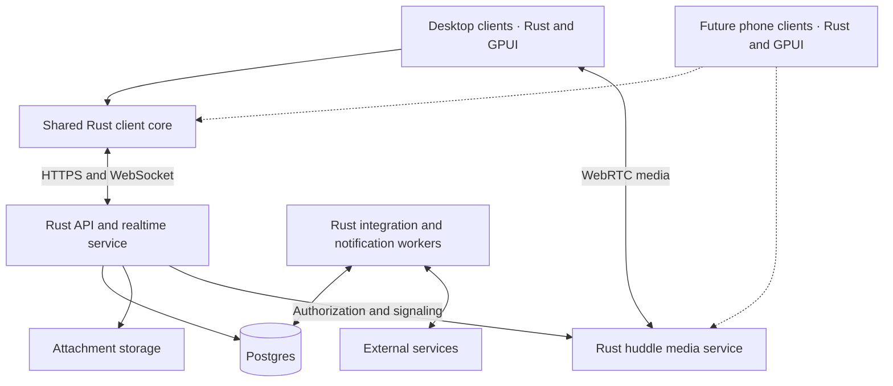

# Lazy application plan

Lazy will combine familiar workplace chat semantics with a polished native interface. Build it around a shared Rust core, GPUI clients, a Rust server, and Postgres, with huddles handled by a separate Rust media service.

The desktop release includes channels, direct and group conversations, threaded discussion, emoji, outside integrations, and huddles with audio, video, and screen sharing. Prepare for native iOS and Android clients from the beginning by keeping application logic independent of GPUI and platform services.

This is an implementation plan. Technology choices below are proposed choices to validate during foundation work, and performance numbers are targets rather than measured results.

## Requirements and platform constraints

- Write Lazy's server and client application code in Rust. Use GPUI for client interfaces; the server remains headless.
- Use Postgres as the only database. Attachment storage and bounded client files do not require another database.
- Follow the Rust best practices and GPUI desktop applications skills, along with repository instructions and the actual dependency versions selected for implementation.
- Make the application beautiful, responsive, accessible, and comfortable for people familiar with Slack.
- Keep the Rust core portable so native phone clients can reuse application behavior, synchronization, protocol types, and huddle state machines.

Current upstream GPUI includes a [native iOS backend](https://github.com/zed-industries/zed/tree/main/crates/gpui_ios). An upstream Android backend was not verified in its [platform configuration](https://github.com/zed-industries/zed/blob/main/crates/gpui_platform/Cargo.toml) during planning on October 28, 2026. Preserve the Rust/GPUI requirement and make Android feasibility an early milestone. An iOS backend's existence does not establish readiness for Lazy's complete mobile workflows.

## Product semantics

Keep the behaviors people already understand, and specify edge cases before implementation.

| Area | Planned behavior |
| --- | --- |
| Workspaces | Separate organizations, memberships, profiles, roles, and settings |
| Channels | Public and private channels, topics, descriptions, membership, favorites, and archiving |
| Conversations | Direct messages and group messages; adding participants creates a new conversation with explicit history rules |
| Groups | Named user groups for mentions, separate from group conversations |
| Threads | One root message with replies, subscriptions, unread state, and an optional reference back into the channel |
| Messages | Formatting, links, code blocks, attachments, editing, deletion, permalinks, and saved items |
| Emoji | Unicode emoji, skin tones, custom workspace emoji, searchable picker, autocomplete, and reactions |
| Attention | Mentions, unread markers, thread inbox, muted channels, notification preferences, status, and do not disturb |
| Discovery | Channel directory, people directory, quick switcher, and permission-aware search |
| Huddles | Channel and conversation huddles with audio, video, screen sharing, and persistent controls |
| Integrations | Incoming webhooks, bots, commands, rich messages, interactive actions, and channel subscriptions |

Define thread notifications, deleted root messages, archived channels, private-channel invitations, membership removal, concurrent message edits, and unread behavior in tested Rust models. Thread replies inherit conversation access. A thread reference in a channel points to the existing reply rather than duplicating its content or identity.

Model workspace roles and authorization explicitly. Server authorization is authoritative for every mutation, history read, search result, attachment request, realtime subscription, and huddle join.

## Experience and visual design

Use a recognizable desktop layout:

- A slim workspace rail.
- A channel and conversation sidebar.
- A central message timeline.
- A resizable thread or details pane.
- A compact huddle dock that remains available while navigating.

Give Lazy its own visual identity: warm neutral surfaces, restrained accent colors, excellent typography, comfortable spacing, clear unread indicators, and expressive emoji. Support light and dark themes through semantic design tokens rather than colors embedded in individual views.

The interactions should carry the polish:

- Channel switching restores drafts, selection, and scroll position.
- Opening a thread preserves the channel's reading position.
- Sending provides immediate feedback with clear pending, confirmed, failed, and unknown-outcome states.
- Hover actions remain available through keyboard navigation.
- The composer grows naturally and supports mentions, emoji, attachments, and formatting.
- Dialogs provide correct focus trapping, dismissal, and focus restoration without interfering with text editing or IME composition.
- Motion is brief, purposeful, and respects reduced-motion settings.
- Loading and reconnecting preserve useful content on screen.
- Empty states and error messages explain the available next action.

Create component specifications and representative screens early. Implement the visual system alongside working workflows, with a dedicated refinement pass before release. Verify layouts at wide, medium, and narrow desktop widths, and keep simulated content visibly labeled.

## Architecture

Separate reusable application logic from GPUI and platform APIs.

Start with a modular application server. Keep media in a separate process because its networking, resource use, and scaling differ from messaging. Carry media directly between client media adapters and the media service; message storage and the client state machine do not carry audio or video frames.

The proposed crate boundaries reflect real reuse and runtime boundaries. Introduce them in dependency order, keep the workspace compiling, and avoid adding abstractions or crates without a concrete responsibility.

| Crate | Responsibility |
| --- | --- |
| `lazy-domain` | Typed identities, message documents, conversation rules, and domain invariants |
| `lazy-protocol` | Versioned API contracts, commands, responses, and event envelopes |
| `lazy-client-core` | Client state machines, drafts, optimistic state, synchronization, and unread calculations |
| `lazy-client-runtime` | Transport, persistence, background work, and platform interfaces |
| `lazy-ui` | GPUI views, composer, timeline, themes, and reusable components |
| `lazy-desktop` | Desktop startup, window lifecycle, assets, and packaging |
| `lazy-server` | Authentication, authorization, application services, Postgres access, and realtime delivery |
| `lazy-media` | Huddle session state and media service implementation |

Keep integration and notification modules inside the server initially; expose worker process modes when isolation is useful. Keep provider credentials and server administration capabilities out of client dependencies.

Use Tokio, Axum, and SQLx for the proposed server stack. Axum integrates with Tokio and Tower; SQLx provides asynchronous Postgres access. Pin compatible versions and a supported Rust toolchain during foundation work. Keep dependency and edition upgrades separate from feature work unless required. [Axum documentation](https://docs.rs/axum/latest/axum/), [SQLx documentation](https://docs.rs/sqlx/latest/sqlx/).

## Durable messaging and synchronization

### Postgres data model

Use Postgres as the only database. Store:

- Users, workspaces, memberships, conversations, and user groups.
- Messages, thread relationships, revisions, reactions, and emoji metadata.
- Read cursors, thread subscriptions, and notification preferences.
- Attachment metadata and access relationships.
- Integration installations, credential references, subscriptions, and deliveries.
- Huddle metadata, operation receipts, durable events, and background jobs.

Use a versioned message document representation with a plain-text projection for search. Keep relational identities, membership, ordering, and integrity constraints explicit rather than burying them in unvalidated JSON.

Store attachment bytes in file or object storage, with access controlled through Lazy. Bound upload sizes, validate declared types, and define cleanup for abandoned uploads.

### Submission and acknowledgment contract

1. The client assigns a stable operation ID and durably records the submission.
2. The server authenticates the caller, checks authorization, and validates the command.
3. A Postgres transaction writes the mutation, operation receipt, and outbox event.
4. The server acknowledges after commit.
5. Clients reconcile optimistic messages with authoritative events.

Enforce idempotency through database constraints and define its scope and retention. If an acknowledgment disappears, query the operation's status before offering a retry. A timeout or dropped task handle does not prove that a remote mutation stopped or failed. Never automatically create a fresh operation for a mutation whose outcome is unknown.

An acknowledgment identifies the revision actually committed. If a newer edit arrives while persistence is in progress, the newer revision remains pending.

### Ordering and replay

Use commit-safe ordering and replay cursors. Specify conversation ordering and the relationship between snapshots, subscriptions, and replay so catch-up cannot skip a concurrently committed event. Do not treat timestamps or a raw database sequence as proof of commit order.

Reconnecting clients catch up from durable events; expired cursors trigger a snapshot refresh. Test edits, deletions, reaction changes, and membership revocation during disconnection. Replay and live delivery must enforce current access permissions.

Postgres `LISTEN/NOTIFY` can wake event dispatchers, while durable tables hold the recoverable data. Its documentation describes this table-backed pattern. Notifications are wake-up hints, and reconnecting dispatchers must query durable state. [Postgres NOTIFY](https://www.postgresql.org/docs/current/sql-notify.html).

### Client persistence and search

Use bounded, versioned files for encrypted drafts and the submission journal, plus a regenerable content cache. This respects the Postgres requirement without requiring a database installation on every device. Obtain encryption keys through platform secure storage. Define atomic replacement, durable-write acknowledgment, interrupted-write recovery, schema compatibility, cache limits, and account sign-out cleanup.

Begin search with Postgres full-text indexing and authorization filters. Search results, snippets, attachments, and integration previews must respect conversation access. Add indexes and change query strategies based on representative query plans and load measurements.

## Huddles

Treat huddles as a substantial engineering track. A WebRTC transport library covers only part of a good calling experience.

The proposed approach is:

- Rust signaling and room authorization.
- A Rust selective forwarding unit, initially evaluating str0m.
- A Rust client transport, initially evaluating webrtc-rs.
- Platform adapters for audio devices, cameras, screen capture, and codecs.
- A validated TURN deployment for restricted networks, including a Rust implementation evaluation to preserve the server language requirement.
- Media processing outside the GPUI foreground thread.

Str0m explicitly targets SFU use, making it a credible starting point for evaluation. WebRTC-rs provides a Rust peer-connection implementation. Neither should be treated as a complete calling product. Validate compatibility and required capabilities at the versions selected for Lazy. [str0m](https://github.com/algesten/str0m), [WebRTC-rs](https://github.com/webrtc-rs/webrtc).

Build in this order:

1. Reliable two-person audio.
2. Multi-person audio through the SFU.
3. Device selection, permissions, mute, reconnect, echo cancellation, and noise handling.
4. Screen sharing.
5. Camera video and adaptive quality.
6. Polished participant views and persistent huddle controls.

Validate a bounded launch capacity, such as 12 participants, before advertising it. Test Bluetooth devices, speakerphone echo, network loss, device removal, permission denial, restrictive networks, and sleep/wake. Define how media failure is reported and recovered without interrupting text messaging.

Use expiring room credentials and enforce conversation membership when joining and while connected. Describe transport encryption accurately; end-to-end encryption would require additional design.

Application code remains Rust. Inventory the native libraries, codecs, and operating-system APIs required by platform adapters; validate their packaging and licensing before committing to the media stack.

## Outside integrations

Start with generic incoming webhooks and one complete provider integration, such as GitHub. This proves installation, subscriptions, delivery, rendering, and administration together.

The integration platform should provide:

- Workspace installation with explicit scopes.
- Channel-specific subscriptions.
- Dedicated bot identities.
- Signed webhook verification and replay protection.
- Durable delivery jobs, bounded retries, and visible failures.
- Provider-event deduplication.
- Credential rotation and revocation.
- Declarative rich messages rendered using Lazy's native components.

Avoid arbitrary remote HTML in messages. Recheck authorization for interactive actions and link previews. Apply outbound network restrictions to preview fetchers and webhook workers, and keep credentials and sensitive payloads out of logs.

Use Postgres-backed jobs initially. Define job ownership, leases, bounded concurrency, shutdown draining, and delivery semantics. Provider actions require provider-specific idempotency or reconciliation because a timeout can leave their outcome uncertain. Distinguish retryable failures from definitive failures and unknown outcomes.

## Native phone preparation

Reuse the Rust domain model, synchronization engine, protocol, message documents, and huddle state machines. Keep these components free of desktop-only assumptions and GPUI dependencies.

Keep platform capabilities behind interfaces for:

- Secure credential storage.
- Notifications and push registration.
- Application lifecycle and background suspension.
- Audio routing, camera, and screen capture.
- File selection, sharing, clipboard, and deep links.

Mobile screens should use a phone navigation model: conversation list to timeline to thread, with touch-sized controls, safe-area handling, and a compact call surface. Share behavior and design tokens while adapting layouts and interaction to the device.

Validate iOS and Android compilation of the shared core immediately. Evaluate GPUI on physical phones early enough to expose rendering, input, accessibility, lifecycle, and power constraints. Design synchronization to resume after suspension; notification delivery cannot depend on a permanent foreground WebSocket.

Android platform support is a feasibility gate. If a suitable GPUI backend is unavailable, maintaining one becomes a separate project that must be estimated explicitly. The shared Rust architecture reduces application duplication, but cannot remove that platform work. Replacing GPUI with another mobile UI framework would be a product decision requiring a change to the stated requirement.

## Delivery milestones

| Milestone | Deliverable | Exit criteria |
| --- | --- | --- |
| Foundation | Rust workspace, pinned GPUI/toolchain, desktop window, CI, migrations, protocol skeleton | Native launch on desktop targets; shared-core mobile builds; documented Android path; two-client audio proof |
| Messaging slice | Sign-in, workspace, one channel, composer, durable send, realtime receive | Two real clients exchange messages; restart and lost acknowledgments produce no loss or duplicates |
| Familiar chat | Channels, DMs, group messages, threads, reactions, emoji, unread state | Core semantics pass end-to-end tests; private access remains enforced during reconnect |
| Daily use | Search, attachments, notifications, quick switcher, settings | Dogfood users can complete normal work without developer assistance |
| Integrations | Webhooks, provider integration, rich messages, delivery controls | Duplicate events and failures recover predictably; credentials can be revoked |
| Huddles | Group audio, video, screen sharing, device controls | Declared participant capacity passes network and device tests |
| Release | Visual refinement, accessibility, installers, updates, operations | Signed packages, verified recovery, native QA, and defined support procedures |
| Phone delivery | Native iOS and Android experiences using the shared core | Physical-device messaging, push, lifecycle, accessibility, and huddle verification |

Keep full huddles and integrations in the desktop release scope. Their prototypes start early even though complete delivery follows messaging. Build one working vertical slice before expanding each workflow.

Estimate the calendar after foundation establishes media and Android costs. Treat desktop delivery and future phone delivery as distinct release milestones with shared foundations.

## Engineering standards

### Rust ownership and APIs

- Give resources a clear owner. Use borrowing for temporary access and owned snapshots when data must outlive its caller.
- Use newtypes for identities and units that could be mixed up, enums for mutually exclusive states, and private fields for invariant-bearing data.
- Validate external data at trust boundaries. Distinguish absence with `Option` and expected failure with `Result`.
- Use structured errors that preserve causes and allow callers to distinguish recovery paths. Reserve panics for documented internal invariants or test setup.
- Keep visibility narrow. Introduce traits at real substitution or runtime boundaries, and avoid unnecessary generics, crate splits, and dependency additions.
- Document observable behavior, ordering, units, ownership, errors, and relevant safety conditions on public APIs.
- Keep dependency and toolchain policy explicit, and inspect duplicate dependency versions and feature activation before adding libraries.

### Async work and lifecycle

- Define who starts work, owns its handle, observes failure, requests cancellation, and waits for shutdown.
- Check each runtime's semantics: dropping a Tokio task handle detaches its task, while GPUI task lifetimes follow GPUI's pinned implementation. Do not transfer assumptions between runtimes.
- Keep synchronous lock scopes short and never hold a synchronous mutex guard across `.await`. Define lock ordering where multiple locks are necessary.
- Move blocking I/O and sustained CPU work off executor threads. Use bounded workers and cooperative stopping where work cannot be forcibly cancelled.
- Bound externally driven input sizes, queues, concurrency, retries, and caches. Define full-queue behavior and shutdown draining.
- Treat suspension points as possible cancellation points. Keep state transitions recoverable and reconcile unknown remote outcomes before retrying side effects.
- Own and reap any child processes; bound retained output and stop only processes the operation owns.

### Unsafe code and platform interfaces

Start with safe APIs. Limit unavoidable unsafe code to small platform or FFI boundaries, with explicit safety arguments. Define allocation and deallocation pairing, ownership transfer, callback lifetimes, buffer bounds, thread affinity, ABI, and unwinding behavior.

Measure representative optimized workloads before introducing unsafe optimizations, custom allocators, atomics, or complex caches. Use fuzzing, Miri, sanitizers, or concurrency-model testing when they address a specific boundary or risk and support the selected targets.

### GPUI behavior

- Keep domain rules testable without a window, with command/effect/event boundaries where they clarify ownership.
- Route buttons, shortcuts, and menus through the same availability and command rules.
- Perform no I/O, heavy parsing, or effect dispatch in `render`; prepare expensive content outside render and cache by identity and revision.
- Guard asynchronous results with target identity, generation, and operation tokens. Never apply a late result to whichever conversation is currently selected.
- Use variable-height virtualized timelines with stable identities and scroll anchoring. Preserve per-conversation scroll, selection, drafts, and expansion.
- Keep selection in a document model so copying can include offscreen messages.
- Implement and verify correct UTF-16 and IME behavior in the composer. Enter during composition must not submit a message.
- Make entity, task, and subscription ownership explicit, use weak back-references where appropriate, and notify the smallest affected view.
- Verify the actual accessibility tree and keyboard workflows. Pure logic tests do not prove native screen-reader behavior or text layout.
- Pin compatible GPUI dependencies to a validated full Zed revision and use platform features and APIs from that revision. Review standalone build requirements and dependency patches before adopting them.

## Verification and release gates

Run formatting, Clippy, workspace tests, migrations, dependency checks, and license checks in CI as appropriate to the established repository policy. Typical Rust checks are `cargo fmt --all --check`, `cargo test --workspace`, and `cargo clippy --workspace --all-targets`. Adapt these to the supported platform and feature matrix; do not indiscriminately enable mutually exclusive features or add warning policies merely to follow a template.

Test behavior and invariants rather than private function order. Use property tests for transformations and state models where useful. Synchronize asynchronous tests on events or conditions with bounded deadlines and useful diagnostics rather than sleeps as proof of ordering.

Required coverage includes:

- Pure domain and client-state tests for permissions, threads, unread state, optimistic updates, and stale results.
- Unicode, emoji, editing, selection, and IME composition tests.
- Postgres integration tests for transactions, idempotency, concurrent commits, event ordering, replay, migrations, and authorization.
- End-to-end tests with real clients, server, and persistence for submit, settle, restart, reconnect, and history paging.
- Crash and fault injection at durable boundaries, including lost acknowledgments, interrupted client writes, storage failures, and worker restarts.
- Native GPUI verification for layout, focus, keyboard input, IME candidate placement, screen readers, display scaling, and sleep/wake.
- Huddle tests under the declared participant capacity, device changes, loss, latency, and restricted networks.
- Integration tests for duplicate provider events, permission changes, credential revocation, and unknown delivery outcomes.

Use provisional performance targets, then validate them on named reference hardware and network conditions:

| Measure | Initial target |
| --- | --- |
| Message durability | Every acknowledged message survives a server-process crash |
| Timeline | Smooth interaction with 10,000 loaded messages and bounded mounted rows |
| Input to frame submission | p95 below 16 ms |
| Message acknowledgment | p95 below 300 ms in the reference region |
| Huddle join | p95 below 3 seconds on the reference network |

Record build, hardware, workload, network conditions, sample size, and measurement method. Frame submission time is distinct from display-presentation latency.

Release work includes backup restoration, schema upgrade compatibility, retention and deletion behavior, signed installers and updates, rollback procedures, runtime dependency and license inventory, and installed-app verification. Define operational targets after representative load and recovery exercises.

Native automation must target only test windows and processes launched for that run. Use disposable profiles, avoid capturing other windows, clean up owned processes, and report incidents plainly.

Record verification as measured, observed, failed, or unverified. Do not claim real IME, screen-reader support, fractional scaling, suspend/resume, or long-session stability from unit tests or a clean compile.

## Skill guidance

This plan incorporates the available substantive guidance from:

- [Rust best practices](/home/jason/.codex/skills/rust-best-practices/SKILL.md), including its concurrency and unsafe-boundary reference.
- [GPUI desktop applications](/home/jason/.codex/skills/gpui-desktop-apps/SKILL.md).

Re-read the relevant skill references and exact pinned dependency source immediately before implementing the corresponding subsystem. Repository requirements and the user's accepted product decisions take precedence over generic patterns.
